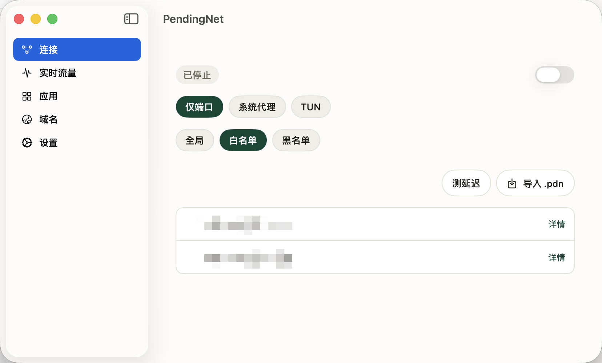

<p align="center">
  
</p>
<h1 align="center">PendingNet</h1>

<p align="center">
  Sing-box部署脚本+配套Mac/iOS客户端
</p>


<p align="center">
  <a href="LICENSE"></a>
  
  
  
  
</p>
苹果生态用 VPS 搭自建节点的全套解决方案

部署脚本 + Mac/iOS 客户端（iCloud 同步）+ 流量统计（分应用、域名统计）+ 节点管理

<p align="center">
  
</p>


协议：默认 TCP 走 Xray Reality，UDP 走 Hysteria2

## 快速开始

**VPS 部署脚本**

```sh
curl -fsSL https://raw.githubusercontent.com/syncmeta/PendingNet/main/deploy/vps-install.sh | sudo bash
```

- **macOS** ： [Releases](https://github.com/syncmeta/PendingNet/releases)
- **iPhone / iPad** ： [TestFlight](https://testflight.apple.com/join/g9jrafTR)

### 分享与删除节点

连接页的节点「详情」可复制或分享标准 VLESS Reality / Hysteria2 链接；已在本机导入同一台 VPS 管理权限时，还可签发十分钟有效、一次性的 `pendingnet://` 普通配对链接。标准链接使用现有节点密钥，配对链接为接收方建立独立用户。链接含访问凭据，请只交给可信的人。

iOS 列表左滑可删除 VPS，确认后先断开当前连接，再删除同步记录和访问凭据；删除标记防止旧设备恢复节点。重新导入可恢复。删除客户端节点不会卸载 VPS，也不会撤销服务器端用户。管理页也支持删除本机管理记录和管理员凭据，iOS 左滑显示删除；连接节点继续保留。繁体中文系统现在可匹配 `zh-Hant` 界面资源。

## 仓库结构

```
cmd/pendingnet-server/   VPS 端：安装、部署、接管、配对、状态
cmd/sbtally/             本机统计的命令行
internal/pnserver/       服务端核心：状态、HTTP API、Release 下载校验、systemd
internal/pairing/        .pdn 的生成与严格校验
internal/source/         Clash API 的 WebSocket 连接流订阅
internal/core/           流量累加、SQLite 存储、查询
internal/daemon/         统计守护进程 + 本地 HTTP/SSE 接口
internal/sbconfig/       sing-box 配置的导入与生成
app/SBTallyCore/         Swift 共享层（模型、配置生成、Keychain、控制协议）+ 全部 Swift 测试
app/SBTally/             macOS app
app/PendingNetHelper/    macOS 特权助手（root，按代码签名校验 XPC 调用方）
app/PendingNetIOS/       iOS app
app/PacketTunnel/        iOS Packet Tunnel Extension（内嵌 libbox）
scripts/                 构建、签名、公证、发布、App Store Connect 查询
deploy/                  vps-install.sh（VPS 一键部署）+ 本机 launchd 部署脚本（早期的自用统计服务）
```

**技术栈**：Go 1.26（`modernc.org/sqlite` 纯 Go 实现，不用 cgo；`github.com/coder/websocket`）·
Swift 6 / SwiftUI · NetworkExtension · sing-box libbox · XcodeGen · Sparkle 2 · systemd · Xray-core · Hysteria2

## 许可

[MIT](LICENSE)

第三方运行时 / 库：sing-box · Xray-core · Hysteria2 · Sparkle 2 · `modernc.org/sqlite` 等，各遵其原协议。
